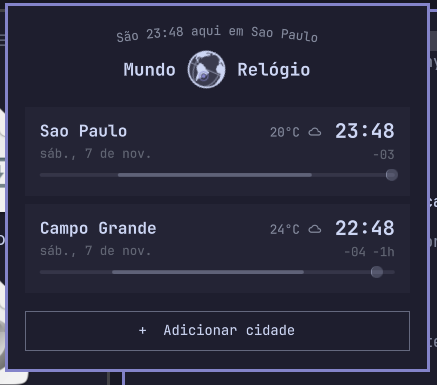

# Elsewhen — relógio mundial em português brasileiro

O relógio mundial da imagem é o **Elsewhen oficial**, ID `omarchy.elsewhen`,
autor Jason Fried, licença MIT. Ele já faz parte do Omarchy instalado; não é um
novo clone comunitário e não tem um repositório PT-BR independente neste projeto.

Na instalação conferida, seu manifest está em
`/usr/share/omarchy/shell/plugins/panels/elsewhen/manifest.json` (versão 1.1.0).
O código usa o catálogo nativo de traduções em
`/usr/share/omarchy/default/i18n/pt-BR/shell.json`. As chaves `elsewhen.world`,
`elsewhen.clock`, `elsewhen.hereIn` e `elsewhen.addCity` fornecem os textos da tela.
O título com globo combina “Mundo” e “Relógio”; a dica do componente usa “Relógio mundial”.

## Usar em PT-BR

Em um Omarchy com esse catálogo instalado, siga o [modo nativo](MIGRACAO-NATIVA.md)
do projeto. Ele seleciona `pt-BR` na shell e preserva as cidades e configurações existentes.
O Elsewhen continua sendo o componente oficial `omarchy.elsewhen`; esta documentação
não instala uma cópia dele nem altera arquivos em `/usr/share/omarchy`.

A captura fornecida mostra São Paulo e Campo Grande como exemplo. Ela não inclui nem
instala o arquivo pessoal de cidades; cada usuário mantém sua própria configuração.
O código e a tradução nativa são mantidos pelo Omarchy. Atualizar este repositório de
plugins comunitários não cria um selo de marketplace separado para o Elsewhen.

## Fonte pública da tradução

O catálogo PT-BR está disponível no [repositório oficial do Omarchy, branch quattro](https://github.com/omacom/omarchy/blob/quattro/default/i18n/pt-BR/shell.json). Foram confirmadas 29 chaves `elsewhen.*`, incluindo os textos exibidos na captura. Para usar a mesma versão, é necessário um Omarchy com suporte ao catálogo nativo; o pacote local conferido é 4.5.0.
