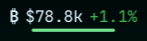
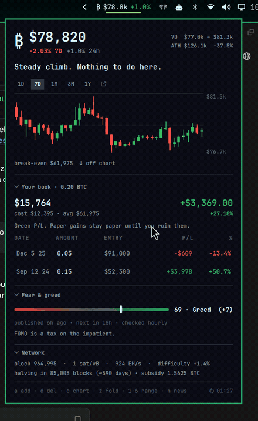
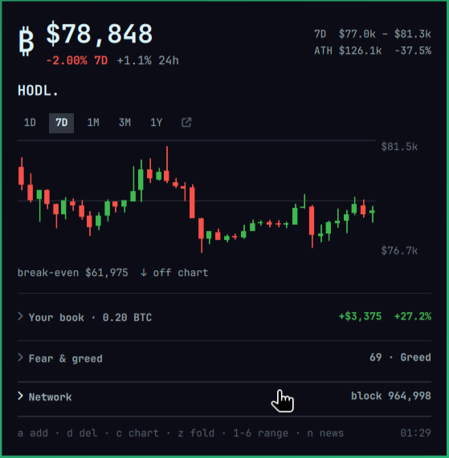
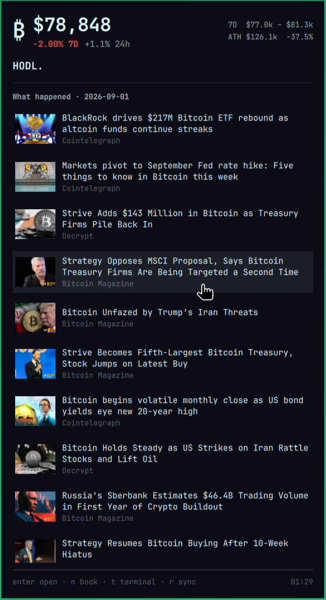

# Instalação independente — robertlindomar.omarchy-ptbr.hodl

Esta é uma tradução comunitária não oficial. O código e os créditos originais estão preservados; veja `LICENSE` e a documentação abaixo. Publicação no GitHub não representa aprovação ou selo Verified do marketplace.

## Instalar este clone PT-BR

```bash
omarchy plugin add https://github.com/robertlindomar/omarchy-ptbr-hodl.git --enable
```

Não habilite simultaneamente o clone e o plugin de origem com a mesma função. Instalar o clone não configura atalhos de teclado.

## Remover este clone PT-BR

```bash
omarchy plugin disable robertlindomar.omarchy-ptbr.hodl
omarchy plugin remove robertlindomar.omarchy-ptbr.hodl --yes
```

Remova também os atalhos manuais que apontem para este ID, se houver. Não apague pastas pessoais de estado para apenas desinstalar o plugin.

## Requisitos e dependências desta edição

Omarchy/Quickshell e `python3` com biblioteca padrão. ImageMagick (`magick`) e `xdg-open` são opcionais. Consulta APIs públicas e feeds externos, descritos abaixo; não exige chaves ou contas.

## Documentação e créditos de origem

Os exemplos de outros atalhos abaixo são opcionais, não configurações aplicadas automaticamente.

# Versão em português brasileiro

Origem: cópia local instalada de `io.github.alvaroeds.hodl`, sem download de fontes.
A licença e a autoria originais estão preservadas nos arquivos deste plugin.
Esta edição mantém as funcionalidades existentes e complementa os textos PT-BR.

O IPC continua sendo `hodl`. Os caminhos de carteira, cache e estado continuam
`~/.local/share/omarchy-hodl` e `~/.local/state/omarchy-hodl` (ou os overrides
`HODL_DATA_DIR`/`HODL_STATE_DIR`). Nenhuma carteira ou dado pessoal foi copiado.
Os cálculos e os valores internos das opções permanecem iguais aos da origem.
Manchetes vindas de serviços externos mantêm o idioma da fonte.

## Documentação original

<h1 align="center">₿ HODL for Omarchy</h1>

<p align="center">
  Bitcoin in the Omarchy bar: live price, your positions and their real profit
  and loss, candlesticks with your break-even drawn on them, the fear &amp; greed
  index, chain stats, a daily digest of what actually happened — and a plugin
  that will not stop telling you to HODL.
</p>

<p align="center">
  <a href="https://github.com/alvaroeds/omarchy-hodl/tags"></a>
  <a href="LICENSE"></a>
</p>

<p align="center">
  
</p>

<p align="center">
  
</p>

## Why

Every price widget shows you a number. None of them know what you paid.

This one does. Record what you bought, when, and at what price, and the panel
answers the only question that matters when you look at bitcoin: **am I up or
down, and by how much** — per position and in total, the way a broker shows
you a stock. Your average cost is drawn straight across the candles, so the
chart stops being decoration and starts being your position.

And because the correct action is almost always none, it keeps saying so.

## What it shows

- **Price** in the bar, refreshed every minute, in any of ten currencies.
- **Your book** — every buy with its date, size and entry price, its
  unrealized P/L in money and percent, and the totals: cost, current value,
  break-even, and how long you have held.
- **Candles** over 1D / 7D / 1M / 3M / 1Y, with your break-even as a dashed
  line and a link out to the full chart when a panel is not enough.
- **Fear &amp; greed**, with yesterday's move and when the next reading lands.
- **The chain** — block height, fees, hashrate, difficulty, and the countdown
  to the next halving.
- **A daily digest** of bitcoin headlines with the article artwork, delivered
  as a notification and readable in the panel.
- **Mantras** matched to the market: `TO THE MOON 🚀` on a green day, `FUD!
  Do not panic sell.` on a red one, and `Not your keys, not your coins.`
  whenever it feels like it. Over a hundred of them.

<p align="center">
  
</p>

Fold any section away with a click or its key. Folding never hides the number
it exists for — a folded book still shows your P/L, a folded sentiment section
still shows `69 · Greed`. `z` folds all three readouts at once, which is the
version worth leaving open all day. The chart is separate: `c` owns it, so
folding the text never puts your chart away or costs a fetch.

The screenshots use a sample portfolio. Yours never leaves your machine.

## Install

```bash
omarchy plugin add https://github.com/robertlindomar/omarchy-ptbr-hodl.git --enable --yes
```

Then bind it to a key — `~/.config/hypr/bindings.lua`:

```lua
o.bind("SUPER + B", "Bitcoin (HODL)", "omarchy-shell hodl toggle")
```

Requires Omarchy 4.x.

### Removing it

```bash
omarchy plugin remove robertlindomar.omarchy-ptbr.hodl --yes
```

That takes the widget out of the bar and deletes the checkout. Your book and
the caches live outside the plugin, so removal never touches them — delete
them yourself if you want them gone:

```bash
rm -rf ~/.local/share/omarchy-hodl ~/.local/state/omarchy-hodl
```

If you added the keybinding or the `hodl` symlink by hand, remove those too:
the line in `~/.config/hypr/bindings.lua` and `~/.local/bin/hodl`.

### What it depends on

Nothing to install and no build step. At runtime it uses only what Omarchy
already ships:

| | |
|---|---|
| `python3` (stdlib only) | every fetch, cache and calculation in `bin/hodl` |
| `curl` / `bash` | not required — the CLI uses Python's own HTTP client |
| ImageMagick (`magick`) | optional; only to shrink news thumbnails. Without it the images are simply stored as downloaded |
| `xdg-open` | optional; opening a headline or the CoinGecko chart |

Public APIs, no keys and no accounts: [CoinGecko](https://www.coingecko.com/)
(price and OHLC), [alternative.me](https://alternative.me/crypto/fear-and-greed-index/)
(fear &amp; greed), [mempool.space](https://mempool.space/) (chain stats), and the
public RSS feeds of Cointelegraph, Bitcoin Magazine, Decrypt and Bitcoin.com.
Article thumbnails are fetched from whatever CDN those feeds point at.

## Keys

| Key | |
|---|---|
| `a` | add a position |
| `j` / `k` | move between positions |
| `d` `d` | remove the selected one (twice, on purpose) |
| `1`–`6`, `h` / `l` | range — `6` is the ↗ chip: the full chart on CoinGecko |
| `c` | show / hide the chart |
| `b` `s` `w` | fold the book / sentiment / network section |
| `z` | fold those three at once, or unfold them — the chart is `c`'s business |
| `n` | the digest — `enter` opens a headline in the browser |
| `t` | the digest in a floating terminal |
| `r` | refresh everything |
| `m` | next mantra |
| `esc` | close |

Left click the pill toggles the panel, right click refreshes, middle click
opens the digest in a terminal, and the scroll wheel changes the range.

## Adding a position

Press `a` and fill three fields:

- **amount** — `0.025` (BTC), `250k sats`, or `$500`, converted at the entry price
- **entry price** — blank means the current market price
- **date** — `YYYY-MM-DD` or `14/03/2025`; blank means today

Both European and American number formats are understood: `78,417` is seventy
eight thousand, `0,05` is five hundredths, `1.234,56` and `1,234.56` are the
same number. A BTC amount never treats a dot as a thousands separator —
`1.000` is one bitcoin, not a thousand.

<p align="center">
  
</p>

## The CLI

`bin/hodl` is the same brain the panel uses, and it works on its own:

```bash
ln -s ~/.config/omarchy/plugins/robertlindomar.omarchy-ptbr.hodl/bin/hodl ~/.local/bin/hodl
```

```
hodl                 price, your positions, P/L, and a mantra
hodl news            today's digest
hodl add <amount> [price] [date]
hodl rm <id>
hodl list
hodl price           one line, for scripts and status bars
hodl mantra          one bitcoin truth
hodl fetch [--sources market,fng,network]
hodl candles --days 7
```

Every command takes `--currency eur` and `--force`.

Over IPC: `omarchy-shell hodl toggle | add | news | chart 1Y | fold all |
refresh | price | status | state`.

## Settings

Setup → Plugins → HODL, or the widget entry in `~/.config/omarchy/shell.json`:

| Setting | Default | |
|---|---|---|
| `currency` | USD | USD EUR GBP CHF JPY CAD AUD MXN ARS BRL |
| `barDisplay` | Price + change | or Price, Change only, Profit / loss, Portfolio value |
| `colors` | Green / red | or Theme, to use the theme's accent and urgent colors |
| `refreshSeconds` | 60 | price poll interval |
| `alertPercent` | 5 | notify when the 24h move crosses this; 0 disables |
| `hodlReminderHours` | 6 | how often the HODL reminder fires; 0 disables it |
| `newsletterHour` | 9 | when the daily digest arrives |
| `notifications` | true | master switch for all three |

## What the numbers mean

- **break-even** — the average price you paid per bitcoin across the whole
  book (total cost ÷ total BTC). Above it you are in profit, below it at a
  loss. Drawn as a dashed line whenever it falls inside the range on screen;
  when it does not, the caption says which way it went.
- **`7D $77.0k – $81.3k`** — low and high of the range you have selected, not
  a fixed 24 hours. It follows the chart, and stays put when you switch to the
  digest and back.
- **`-1.96% 7D`** — the headline percentage follows the selected range too.
  The dim line beside it keeps the standard windows for reference. **The bar
  pill is always 24h**, whatever the panel is showing.
- **ATH** — the all-time high and how far below it the price is now. This one
  never changes with the range.
- **P/L** — unrealized: what a position is worth now minus what it cost.
  Money on the left, percent on the right. Nothing here is realized until you
  sell, which you are not going to do.

## How it refreshes

Each source moves at the speed of the thing it measures:

| Source | Automatically | |
|---|---|---|
| Price | every 60s, always | the one value the bar shows with the panel shut |
| Fear &amp; greed | every hour | the index is published once a day |
| Chain stats | every 15 min, only while the panel is open | nothing outside the panel shows them |
| Candles | never on a timer | on open, on a range change, and on `r` |
| Digest | once a day | plus `n` / `r` on demand |

Hovering the pill refreshes a price that has gone cold. Nothing ever blanks
while it reloads: values stay on screen, a small spinner marks what is in
flight, and a source that fails keeps its last good reading.

## Rate limits, and why this does not hammer anyone

QML never touches the network. `bin/hodl` owns every request and caches each
source on disk with its own TTL, so a one-minute poll only reaches an API that
has actually gone stale.

CoinGecko's free tier answers a throttled request with **HTTP 200 and the 429
buried in the JSON body**, so it is detected by content rather than status
code. When it trips, the plugin backs that host off (45s → 15min, respecting
`Retry-After`), keeps serving the last good values, and says so next to the
chart. Two requests to the same host are never fired within four seconds.

## Your data

```
~/.local/share/omarchy-hodl/positions.json    your book — back this up
~/.local/state/omarchy-hodl/                  caches, digest, thumbnails
```

`positions.json` is plain JSON, watched for changes, and yours — it outlives
an uninstall on purpose. Nothing is sent anywhere: the plugin talks to CoinGecko, alternative.me, mempool.space
and four RSS feeds, and none of them are told what you own. There is no
account, no key, no telemetry.

## Not financial advice

It is a price display with a strong opinion. The opinion is HODL.

## License

MIT — see [LICENSE](LICENSE).
